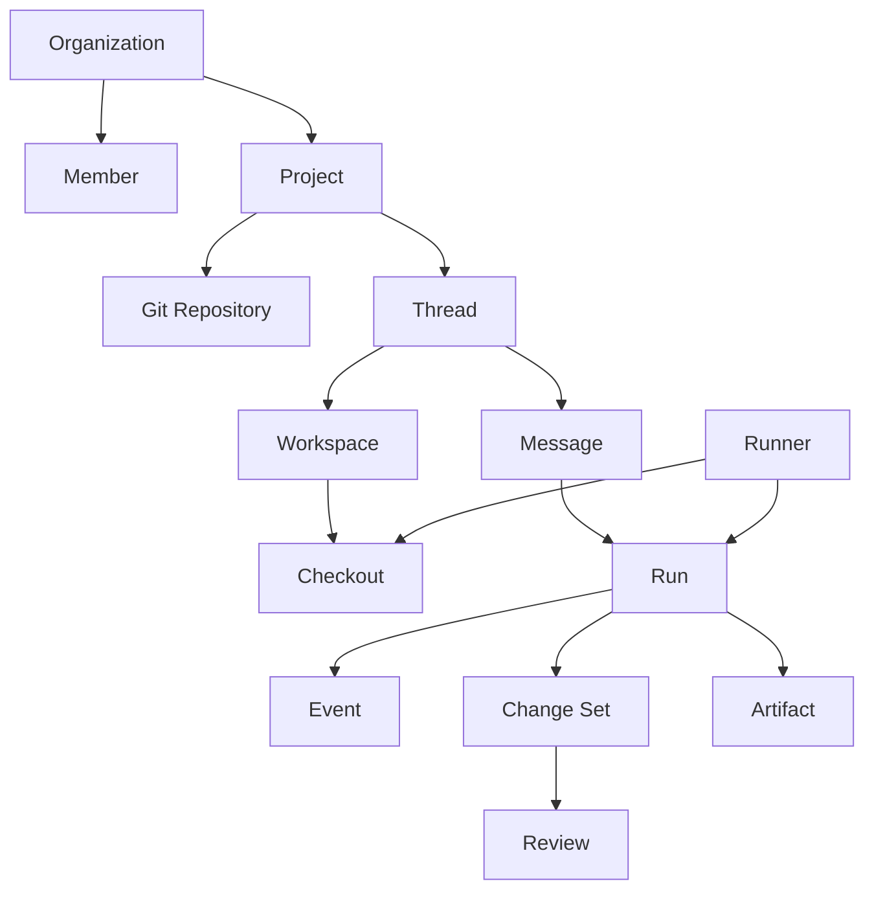
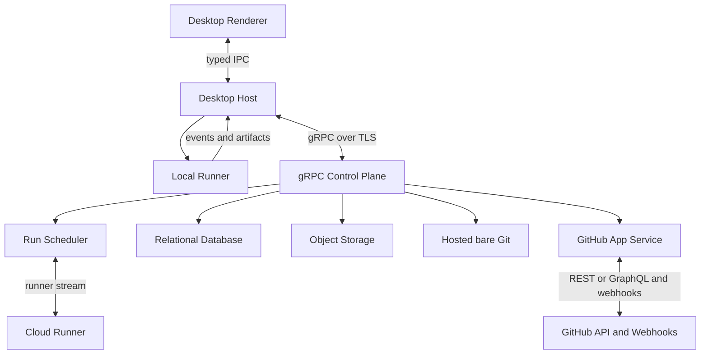
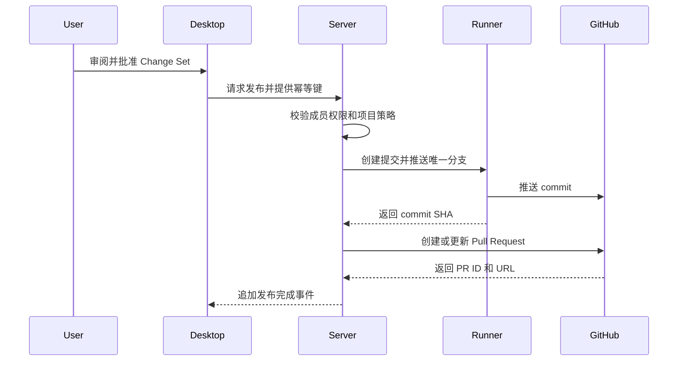
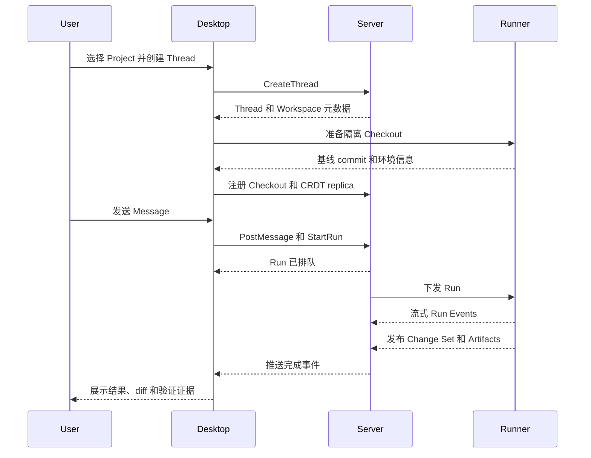

# 核心概念

武当（Wudang）是一个面向软件研发的协作式 Agent 工作空间。用户在一个持续存在的
**线程（Thread）** 中描述目标，Agent 在与线程绑定的隔离
**工作空间（Workspace）** 中修改代码，团队成员审阅变更，并在明确授权后通过 GitHub
发布分支或 Pull Request。

> 本文描述目标产品模型与推荐的 MVP 架构，而不是当前仓库已经实现的功能。当前代码仍处于
> 协议与客户端脚手架阶段。

## 产品方向

推荐把武当定义为一个 **Agent 协作控制面**，而不是“带聊天框的代码编辑器”：

- **服务端是控制面与协作存储**：管理身份、组织、项目、线程、权限、事件历史、CRDT delta、
  托管 Git 仓库和外部集成。
- **客户端是交互面与默认执行面**：展示线程和审阅界面，在本机准备代码、运行 Agent
  工具和命令，并通过 gRPC 与服务端同步状态。
- **Git 是代码发布面**：内网部署可以使用武当托管的 bare Git；公网项目可以接入 GitHub，
  并使用 Pull Request、Checks 和 GitHub review。
- **Runner 是可替换的执行面**：MVP 先支持本地 Runner，以后可以增加云端 Runner，而不改变
  Thread、Run 和 Workspace 的领域模型。

这个边界允许第一版保持本地执行，同时由协作层持久化已加入 Project 的文本 Document。
ignored 文件、密钥和未挂载目录仍只留在本机；源码进入协作层前必须向用户说明加密、驻留与
保留策略。

## 设计原则

1. **线程是工作的主轴**
   对话、运行、文件变更、测试结果、审阅意见和发布记录都应能回到同一条时间线。

2. **隔离优先，共享必须显式**
   每个线程默认获得独立工作空间。多个 Agent 不应默认写入用户正在使用的主检出目录。

3. **执行与协调分离**
   服务端决定“谁可以做什么、任务处于什么状态”；Runner 决定“命令在哪里执行、文件如何
   落盘”。

4. **Git 是发布事实源，Provider 能力显式分层**
   武当托管仓库以标准 Git object/ref 为事实源；GitHub 仓库以 GitHub 的分支、PR、Checks 和
   合并状态为事实源。协作层不复制另一套提交历史。

5. **所有有副作用的操作都可追踪、可重试、可归因**
   创建运行、执行工具、写文件、推送分支和创建 PR 都需要稳定 ID、幂等键和操作者信息。

6. **发布动作必须由用户明确授权**
   Agent 完成工作不等于可以推送、创建 PR、合并或发布。高风险动作应是独立命令，并在界面中
   显示目标仓库、分支和影响范围。

## 领域模型

### Organization 与 Member

**Organization** 是权限与计费边界。**Member** 是用户在组织中的身份，至少包含
`owner`、`admin`、`member` 三种角色。仓库访问权不能只由组织角色推导：托管仓库受 Project
ACL 约束，GitHub 仓库还必须受 GitHub App 安装范围约束。

MVP 即使只提供个人空间，也应保留 `organization_id`，避免后续把所有数据和权限模型重写一遍。

### Project 与 Repository

**Project** 是武当中的协作单元，保存：

- 关联的武当托管或 GitHub 仓库；
- 默认分支和允许发布的分支规则；
- 可用 Runner、Agent、模型和工具策略；
- 成员及其权限；
- 源码、日志和制品的保留策略。

**Repository** 是 Git 仓库的逻辑身份。武当托管仓库使用服务端 UUID，GitHub 仓库使用 GitHub
repository ID；名称与 `owner/name` 都只是可变的可读属性。

第一版建议一个 Project 只关联一个 Repository。数据模型可以允许未来一个 Thread
挂载多个 Project，但 UI 和运行时不必在 MVP 中支持多仓库任务。

### Thread

**Thread** 是一次可持续、可分享、可恢复的工作上下文，不只是消息列表。它包含：

- 用户、Agent 和系统消息；
- 每次 Agent 响应对应的 Run；
- 与项目绑定的 Workspace；
- 文件变更、命令结果和制品；
- 审阅意见、决策和发布记录；
- 按顺序追加的事件历史。

线程可以长期存在，也可以 fork。Fork 应从一个明确的 `event_id` 或 `revision` 创建新的
线程和工作空间历史，之后独立演进；它不会自动把变更合回父线程。

### Workspace 与 Checkout

**Workspace** 是“某个线程针对某个项目的可变代码状态”。它是产品领域对象，不等同于磁盘
目录，也不等同于 GitHub 分支。

**Checkout** 是 Workspace 在某一台机器上的磁盘实现。MVP 推荐使用独立 Git worktree 或
独立 clone 来创建 Checkout：

- `isolated`：由武当管理的目录，默认模式；线程之间互不覆盖文件。
- `existing`：用户已有的本地检出目录；修改立即出现在该目录中，必须显示并发写入警告。

为避免混淆，产品文案统一使用“工作空间（Workspace）”；只有在描述 Git 的具体实现时才使用
“Git worktree”。

一个 Workspace 可以在不同机器上产生 Checkout。文本文件通过 CRDT delta 实时协作：每个
编辑携带 Git base、causal frontier 和稳定 DeltaId，服务端持久化后再确认并广播。Checkout
仍然是本机物化结果，不是共享事实源。

文件新增、删除、重命名和 mode change 在 MVP 中使用带 `expected_revision` 的串行 Workspace
命令；文本内容使用多写者 CRDT。完整文件树 CRDT 需要单独解决并发 rename/delete、目录循环和
跨平台路径语义，不能直接套用文本算法。

详细模型见[协作与 Delta 数据模型](./collaboration.mdx)。

### Message、Run 与 Event

**Message** 是人或 Agent 在 Thread 中发布的内容。用户发送一条请求后，系统创建一个
**Run**。Run 表示一次有明确输入、执行位置和结果的 Agent 尝试。

Run 至少记录：

- `run_id`、`thread_id`、触发它的 `message_id`；
- Agent、模型、Runner 和协议版本；
- `queued`、`running`、`waiting_for_input`、`succeeded`、`failed`、`cancelled` 状态；
- 开始、结束时间和错误原因；
- 输入 revision 与输出 revision。

**Event** 是线程和运行的追加式事实，例如：

- `message.created`
- `run.started`
- `run.output.delta`
- `tool.requested`
- `tool.completed`
- `workspace.change_published`
- `review.comment.created`
- `github.pull_request.created`
- `run.completed`

客户端可以把 Event 投影成消息列表、运行进度和审阅视图。不要只同步一个可覆盖的
`status` 字符串，否则断线重连、审计和多客户端一致性会很快失控。

### Change Set、Review 与 Artifact

**Change Set** 是某个 Workspace 从一个 revision 到另一个 revision 的不可变变更，包含文件
清单、diff、基线提交和生成它的 Run。它不是 Git commit；用户审阅通过后才可以选择提交和
发布。

**Review** 对 Change Set、文件或具体行发表评论，并记录 `pending`、`changes_requested`、
`approved` 等状态。新的 Change Set 不应覆盖旧审阅，而应标明哪些评论已经过期。

**Artifact** 是运行产生但不应混入消息正文的数据，例如测试报告、构建日志、截图和补丁包。
大对象放入对象存储，事件中只保存稳定 ID、摘要、大小、内容类型和访问策略。

Agent 的 `apply_patch` 原文用于工具审计，不直接作为审阅模型。Host 在确定的 base revision
上预演 patch，把 before/after 规范化成 CRDT TextDelta，并从接受前后的快照生成 Change Set。
Agent 模式展示结构化 diff，评论锚定不可变 Change Set；“Open in Edit”打开相同 head revision
的实时 Document。

### Runner

**Runner** 是实际执行 Agent 工具的进程，可以位于：

- 用户桌面客户端；
- 团队自托管机器；
- 武当云端执行环境。

所有 Runner 使用同一套 Run、Tool Call 和 Event 协议。调度器只选择符合项目策略的 Runner，
不应让“本地运行”和“云端运行”变成两套产品模型。

### Integration

**Integration** 表示外部系统连接。GitHub 是第一种 Integration，但身份登录和仓库授权必须
分开建模：

- **用户登录**回答“这个人是谁”；
- **GitHub App Installation** 回答“武当可以访问哪些组织和仓库”；
- **Project 授权**回答“这个成员能否在武当中操作该仓库”。

## 数据事实源

| 数据 | 事实源 | 说明 |
| --- | --- | --- |
| 用户、组织、成员、项目、权限 | 服务端数据库 | 所有查询按 `organization_id` 做租户隔离 |
| Thread、Message、Run、Event、Review | 服务端数据库 | Event 追加写，读模型可重建 |
| Workspace revision、Document frontier、CRDT delta | 服务端数据库 | 文本操作按 causal graph 合并 |
| Checkout 文件与进程 | Runner 本地磁盘 | 从 Git base、snapshot 和 delta 恢复 |
| Change Set、日志、附件、压缩快照 | 对象存储 | 源码保留期限由 Project 策略控制 |
| 托管 Commit、Branch、Tag | 服务端 bare Git | Git object/ref 保持标准格式，存放于加密卷 |
| GitHub PR、Check、Merge | GitHub | 服务端缓存外部 ID 和同步游标 |
| 用户 refresh token、设备密钥 | 操作系统安全存储 | 不进入渲染进程、日志或仓库 |
| GitHub App 私钥 | 服务端 KMS / Secret Manager | 不下发给客户端 |

## 系统架构

### Desktop Renderer

负责路由、消息流、diff、审阅和设置界面。Renderer 不直接持有服务端 token、GitHub token、
文件系统权限或任意命令执行能力。

### Desktop Host

Electron 主进程是桌面端的信任边界，负责：

- 与 Renderer 的类型化 IPC；
- gRPC 连接、会话刷新和断线重连；
- 本地 Checkout 生命周期；
- 启停 Local Runner；
- 操作系统钥匙串、文件选择器和通知。

当前应以 `client/apps/desktop` 作为 MVP 主客户端。`client-gpui` 可以保留为原生客户端实验，
但在领域协议稳定前不要同时实现两套产品界面。

### Control Plane

服务端是无状态 gRPC API 与有状态后台任务的组合。API 处理命令和查询；调度器、GitHub webhook
消费者、制品处理器等后台任务通过持久队列工作。PostgreSQL 保存用户、会话、仓库元数据和
加密协作记录；标准版使用 Tokio，Linux 高并发版把 Blob 文件 I/O 分派给独立 `io_uring`
worker。详细实现见[服务端架构](./backend-architecture.mdx)。

## gRPC 契约

`proto` 是客户端和服务端共同的产品契约。建议统一使用版本化 package，例如
`wudang.thread.v1`，并按领域拆分服务：

| 服务 | 职责 | 典型 RPC |
| --- | --- | --- |
| `AuthService` | JWT 会话和设备身份 | `RegisterLocal`、`LoginLocal`、`BeginOAuth`、`RefreshSession` |
| `OrganizationService` | 组织和成员 | `ListOrganizations`、`InviteMember` |
| `ProjectService` | 项目、仓库和策略 | `CreateProject`、`GetProject`、`ListProjects` |
| `ThreadService` | 线程和消息 | `CreateThread`、`PostMessage`、`ForkThread` |
| `EventService` | 实时事件与恢复 | `SubscribeThreadEvents` |
| `CollaborationService` | 文本 CRDT 与 Presence | `SyncDocument`、`GetDocumentSnapshot` |
| `RunService` | 创建、取消和观察运行 | `StartRun`、`CancelRun`、`ConnectRunner` |
| `WorkspaceService` | 文件树 revision 与 Checkout | `RegisterCheckout`、`ApplyFileOperation` |
| `ChangeService` | patch、diff 与审阅 | `PreviewPatch`、`ApplyPatch`、`CreateReviewComment` |
| `RepositoryService` | 武当托管 Git 元数据 | `CreateHostedRepository`、`ListRepositories` |
| `GitHubService` | 安装、仓库和发布动作 | `ListInstallations`、`CreatePullRequest` |
| `ArtifactService` | 大对象上传下载 | `CreateUpload`、`GetDownload` |

### 命令、查询与事件

- **查询**使用 unary RPC，返回某一 revision 的快照。
- **命令**使用 unary RPC，接收 `request_id` 或 `idempotency_key`；成功表示命令已被接受或
  已提交，不代表长任务已经完成。
- **事件**使用 server streaming RPC。每个 Event 都有单调递增的 cursor，客户端断线后以
  `after_cursor` 续订。
- **文本协作**使用 bidirectional streaming RPC。首帧打开 Document，之后双向传输 causal
  delta、Ack、Presence 和 heartbeat；重连携带本地 frontier，只补缺失历史。
- **Runner 通道**可以使用双向 streaming RPC，Runner 上报心跳和执行事件，服务端下发已经
  持久化的任务。
- 大文件不经过长连接直接传输；服务端签发短期上传或下载 URL，gRPC 只传元数据。

所有写 RPC 应包含：

- 稳定的 `request_id`，用于幂等重试；
- `expected_revision`，用于乐观并发控制；
- 服务端生成的资源 ID，不依赖客户端本地路径；
- 可机器处理的错误码，以及面向用户的安全错误信息。

认证信息、追踪 ID、客户端版本和协议版本放在 gRPC metadata；业务归属字段仍放在 message
中。所有连接使用 TLS，服务端通过 interceptor 统一完成认证、授权、限流和审计。

`proto/sync.proto` 只负责持久化领域事件投影，不承载文本编辑；`proto/collab.proto` 负责
CRDT 文档流；`proto/changes.proto` 负责 patch、Change Set 与 Review。公网默认使用浏览器
OAuth/OIDC 授权码流程加 PKCE；无外部 IdP 的内网部署可以启用本地账号，密码仅通过 TLS
传输并保存为 Argon2id PHC hash。服务端签发短时 JWT Access Token，Refresh Token 是随机不透明
令牌且数据库只保存带 pepper 的摘要；客户端把 Refresh Token 放入系统安全存储。

### 客户端双模式

桌面端完整支持 Edit 与 Agent 两种模式：

- **Edit** 直接编辑实时 Document，显示文件、光标坐标、语法高亮和 Presence；
- **Agent** 展示 Thread、Run、Tool Call、验证结果和 `apply_patch` 的 Change Set diff；
- 两种模式共享同一个 Workspace head，“Open in Edit”不能复制一份脱离协作流的文本；
- 第一版使用 CodeMirror 6 与 Merge View，自研 Rope/SumTree、DisplayMap 和 GPU renderer
  按独立阶段演进。

数据结构、坐标、IBM Plex Mono、语法高亮、文本渲染与 vgpu 调研见
[客户端编辑器架构](./editor-architecture.mdx)。

### 客户端传输边界

Electron 的 Renderer 不适合直接建立拥有高权限凭据的 gRPC 连接。推荐由 Desktop Host 使用
原生 gRPC 客户端连接服务端，再通过窄化的 IPC API 暴露给 Renderer。

如果以后提供纯 Web 客户端，可在同一领域服务前增加 gRPC-Web 或 Connect 网关；不要为了浏览器
兼容把第一版内部协议降级成无类型 JSON 同步接口。

## GitHub 集成

### 使用 GitHub App

仓库访问推荐使用 GitHub App，而不是要求用户粘贴 Personal Access Token：

- Installation 明确限定组织与仓库范围；
- 服务端按需签发短期 installation token；
- 权限可在 GitHub 中统一撤销；
- webhook、Checks 和 PR 身份归属更清晰。

用户使用 GitHub 登录武当，并不自动意味着某个 GitHub App Installation 已授权给该用户或
Project。服务端每次执行仓库动作时都要同时校验武当权限和 GitHub 安装范围。

### Webhook 流程

1. GitHub 将事件发送到服务端 webhook endpoint。
2. 服务端先校验签名、记录 delivery ID 和原始事件摘要。
3. 重复的 delivery ID 幂等返回成功。
4. 合法事件进入持久队列，endpoint 尽快响应 GitHub。
5. 消费者更新仓库、PR 和 Check 缓存，并向相关 Thread 追加领域 Event。
6. 定时 reconciliation job 补偿漏掉或乱序的 webhook。

不要把 webhook payload 直接当作内部领域对象。先转换成带外部 ID、版本和发生时间的内部事件，
以隔离 GitHub API 变化。

### 发布流程

分支名应包含稳定的 thread 短 ID，例如 `wudang/t-01abc-fix-login`。服务端必须保存 GitHub
返回的数字 ID 或 node ID；URL 和标题不是稳定主键。重试创建 PR 时先用幂等记录和 head branch
查找已有 PR，避免产生重复资源。

合并 PR、删除分支、发布包等高风险动作不属于“Run 成功”的隐含后续步骤，必须是单独授权的
命令。

## 一致性、断线与冲突

### Revision 与 Causal Version

Thread 和 Workspace 的非文本命令维护单调递增 revision。客户端提交命令时携带它最后看到的
`expected_revision`：

- 相等：服务端接受命令并产生新 revision；
- 不相等且命令可安全重放：服务端返回最新状态并允许客户端重试；
- 不相等且存在语义冲突：返回 `ABORTED`，要求用户刷新或明确解决。

不要使用客户端时间戳决定顺序。时间用于展示，cursor 和 revision 用于一致性。

Document 文本不使用单一 revision 排序并发编辑，而使用 Git base 加 causal frontier。旧
version 中的 UTF-8 offset 通过 fragment index 翻译到当前版本；Presence、选区和实时评论
使用 StableAnchor。

### 离线与重连

MVP 支持“连接中断后恢复”，不承诺完全离线创建协作历史：

1. 客户端持久化最近确认的 event cursor、Document frontier 和未确认 delta WAL；
2. 重连时先刷新会话，再从 cursor 续订领域事件并重新打开 Document stream；
3. 服务端重放事件与缺失 delta；
4. 历史已压缩时返回 snapshot 和新的 frontier；
5. 未确认命令使用原 idempotency key，未确认 delta 使用原 DeltaId 重试。

### 文件冲突

同一 Document 的文本并发由 CRDT 收敛；语法上可合并不代表语义正确，因此并发修改同一函数
仍需要测试和审阅。把 Child Thread 或另一个 Workspace 的 Change Set 引入当前 Workspace
时，优先把有来源的文本变更重放为 delta；文件树冲突使用 Git 三方合并并生成新的 Change Set。
导入成功不等于允许推送或合并。

## 安全边界

- 每个服务端资源都携带 `organization_id`，授权查询不能只依赖前端传入的父资源。
- Runner 接收最小权限、短时效、单仓库凭据；凭据不得写入命令日志、Artifact 或 Workspace。
- Desktop Renderer 保持 `contextIsolation` 与 sandbox，通过白名单 IPC 调用 Host。
- Tool Call 在执行前经过项目策略：只读、写文件、网络访问、命令执行和发布动作分别授权。
- 命令输出和 diff 在上传前进行 secret scanning；检测到疑似密钥时默认阻止分享和发布。
- GitHub webhook 校验签名，外部 URL 下载防止 SSRF，归档解压限制路径穿越与压缩炸弹。
- 审计日志记录操作者、资源、动作、结果和 request ID，但不记录 token、完整环境变量或敏感
  文件内容。
- 数据删除需要覆盖数据库、对象存储、Runner 缓存和 GitHub 安装解绑流程。

## 关键工作流

### 创建线程并运行 Agent

### 审阅与迭代

用户可以针对消息、文件或 diff 行创建 Review Comment。后续消息引用这些 comment ID，新的 Run
从最新已确认 Workspace revision 开始。Run 不应静默覆盖用户在同一 Checkout 中产生的未提交
变更；检测到基线漂移时应暂停并请求选择：

- 将本地变更纳入新的 Change Set；
- 暂存本地变更后继续；
- 创建新的隔离 Workspace；
- 取消 Run。

## MVP 实施路线

### 第一阶段：协议骨架

目标是建立一个可演进的端到端连接，而不是先铺满 UI。

1. 确定 ID、时间、分页、错误、幂等键、revision、causal frontier 和 event cursor 规范。
2. 实现 `AuthService`、`SyncService`、`CollaborationService` 和 `ChangeService` 的最小接口。
3. Desktop Host 建立 TLS gRPC 连接、登录会话、自动重连和事件续订。
4. 用两个 replica 的乱序、重复和断线重发 property test 证明文本 convergence。
5. 建立一条可观测链路：每个命令和 delta 都能贯穿客户端、服务端和日志。

### 第二阶段：本地执行闭环

1. 用户打开已有 Git 仓库的本地 clone，或创建武当托管仓库。
2. 创建 Project、Thread 和隔离 Checkout。
3. Edit 模式把编辑事务发送为 CRDT TextDelta，并显示远端 Presence。
4. Local Runner 接收一个 Run，流式返回文本与 Tool Call。
5. Agent `apply_patch` 转换为 attributed delta，并发布不可变 Change Set。
6. Agent 模式展示 diff、日志、验证和成功或失败状态。
7. 关闭并重开客户端后，线程和 Document 可以从事件、snapshot 与本地 WAL 恢复。

这条链路完成前，不要优先实现多 Agent 编排、插件市场或 WebGPU 自研文本 renderer。

### 第三阶段：Git 发布闭环

1. 内网部署创建标准 bare Git 仓库；公网部署安装 GitHub App 并选择仓库。
2. 用武当 repository UUID 或 GitHub installation/repository ID 建立 Project。
3. 用户批准 Change Set 后，Runner 创建 commit 并推送唯一分支。
4. 托管模式记录分支与 review；GitHub 模式创建 PR 并把 webhook 状态同步回 Thread。
5. UI 展示 review、Checks 和 merge 状态，但合并仍需独立授权。

### 第四阶段：团队与远程 Runner

在本地闭环稳定后，再增加组织邀请、线程分享、角色权限、自托管 Runner 和云端 Runner。远程
Runner 必须复用既有协议，不能要求客户端理解另一套 Run 生命周期。

## 当前仓库的落点

| 路径 | 当前状态 | 推荐下一步 |
| --- | --- | --- |
| `client/apps/desktop` | Edit/Agent 双模式原型 | 接入真实 Host API、Workspace 和 Collaboration stream |
| `client-gpui` | Rust 空壳实验 | 暂停产品功能开发，仅用于验证原生 UI 可行性 |
| `proto/auth.proto` | 本地账号与 OAuth/PKCE 会话契约 | 客户端接入 JWT/Refresh Token rotation |
| `proto/sync.proto` | 领域事件订阅与 snapshot | 实现 event store、cursor retention 和 ack |
| `proto/collab.proto` | 双向 CRDT 文档流 | 实现 causal graph、fragment index、WAL 和 convergence tests |
| `proto/changes.proto` | patch、Change Set 与 Review | 把 Runner `apply_patch` 接到 diff 审阅链路 |
| `server` | Rust crate workspace 与可运行 gRPC 服务 | 补齐 Project/Thread/Runner、Git smart transport 和部署测试 |
| `docs/worktrees.mdx` | 尚未定义 | 单独记录 Checkout 创建、恢复、清理和冲突策略 |

服务端第一版建议采用**模块化单体**，而不是微服务。认证、线程、调度、Workspace 和 GitHub
集成按模块保持清晰边界，但部署为一个 API 进程加一个 Worker 进程。等到负载、故障域或团队
边界真的要求拆分时，再依据事件和 protobuf 契约拆服务。

## 需要尽早确认的架构决策

建议用 ADR 固化以下默认答案：

| 决策 | MVP 推荐 |
| --- | --- |
| 主客户端 | Electron；GPUI 暂作实验 |
| 默认 Runner | 本地 Runner |
| 服务端源码策略 | 持久化已挂载文本的加密 delta/snapshot；ignored 文件与密钥不上传 |
| 文本并发 | 多 replica CRDT；文件树操作暂时用 Workspace revision 串行化 |
| 本地隔离实现 | Git worktree，无法使用时回退独立 clone |
| 仓库 Provider | 内网使用武当托管 bare Git；GitHub 使用 GitHub App |
| 服务端形态 | 模块化单体 + Worker |
| 同步模型 | 领域 Event + 文本 CRDT delta + snapshot，不做通用 JSON 同步 |
| 发布策略 | 审阅后显式创建 commit、branch 和 PR |
| 首发仓库提供商 | 武当托管 Git 与 GitHub；Provider 特有能力不抽象成最低公分母 |

CRDT 首先限定为文本 Document；如果未来扩展到完整文件树或 Agent 默认在云端运行，需要重新
评估目录操作、源码加密、数据驻留、snapshot compaction 和 Runner 信任模型。不要因为文本
CRDT 已经存在，就假设 rename、delete 和权限变更可以使用同一算法。

## MVP 完成标准

第一版的完成标准不是页面数量，而是以下闭环在断线、重试和失败场景下仍然成立：

> 用户连接一个托管或 GitHub 仓库，在隔离 Workspace 中发起 Agent Run，实时看到过程，审阅
> 可追踪的 Change Set，明确授权后发布 Git 分支或 Pull Request，并能从同一 Thread 回看每一步
> 是谁、在何处、基于哪个 revision 完成的。

任何新功能都应先回答：它属于控制面、执行面还是发布面；它产生什么领域 Event；它的事实源
在哪里；失败重试是否会重复产生副作用。答不清这四个问题时，先不要扩展协议。
