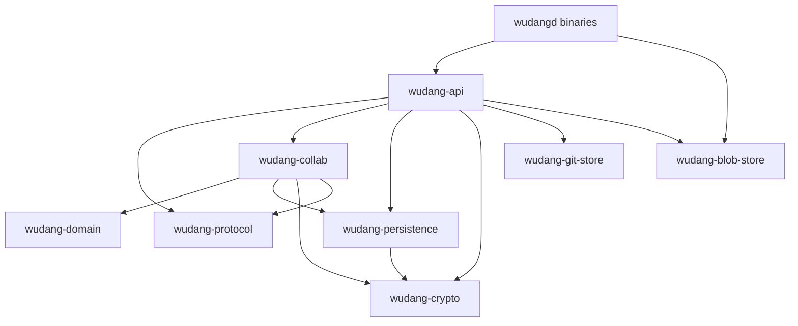

# 服务端架构

服务端采用 Rust workspace 形式的模块化单体。领域边界通过 crate 和 protobuf 保持清晰，但
第一版仍作为一个 gRPC 进程部署，避免在业务模型尚未稳定时承担微服务网络、部署和一致性成本。

## Crate 布局

| Crate | 职责 |
| --- | --- |
| `wudang-protocol` | 从仓库根目录 `proto` 生成 Tonic/Prost 类型与 descriptor set |
| `wudang-domain` | 不依赖网络和数据库的 CRDT 文本领域内核 |
| `wudang-crypto` | JWT、Argon2id、Refresh Token 摘要和 AES-256-GCM |
| `wudang-persistence` | PostgreSQL 用户、会话、仓库元数据和加密 delta journal |
| `wudang-git-store` | 标准 bare Git repository 创建、打开与存储策略 |
| `wudang-blob-store` | 加密 Blob 抽象、Tokio backend 与 Linux `io_uring` backend |
| `wudang-collab` | Document room、CRDT 应用、持久化、恢复和广播 |
| `wudang-api` | Auth、Sync、Collaboration、Change 和 Repository gRPC 服务 |
| `wudangd` | 可移植 Tokio 服务入口 |
| `wudangd-uring` | Linux 高并发入口，使用独立 `io_uring` Blob workers |

依赖方向保持从 transport 指向领域：



`wudang-domain` 不导入 protobuf、Tonic、SQLx 或 Git，因此 CRDT convergence 可以独立做
property test。

## 认证与 JWT

### 登录方式

- 公网部署以 OAuth/OIDC Authorization Code + PKCE 为默认；
- 无 GitHub、无外部 IdP 的内网部署可以启用 `RegisterLocal` 与 `LoginLocal`；
- `RegisterLocal` 默认关闭，只能由部署者显式设置 `WUDANG_ALLOW_LOCAL_REGISTRATION=true`；
- 本地密码只允许在 TLS gRPC 上传输，使用 Argon2id 默认安全参数生成 PHC string；
- 数据库永远不保存明文密码或可恢复密码。

### Token

Access Token 是 JWT，当前模块化单体使用 HS256：

```json
{
  "sub": "user uuid",
  "sid": "session uuid",
  "iss": "wudang",
  "aud": "wudang-desktop",
  "iat": 0,
  "exp": 0,
  "jti": "unique token uuid"
}
```

- 默认有效期 15 分钟；
- 除登录和刷新 RPC 外，gRPC service 通过 Tonic interceptor 校验 `Authorization: Bearer …`；
- JWT secret 至少 32 bytes，通过环境或 Secret Manager 注入；
- 未来拆微服务时应迁移到 EdDSA/ES256，验证服务只持有公钥。

Refresh Token 是 32 bytes CSPRNG 生成的 URL-safe 不透明令牌：

- 客户端只放入系统钥匙串；
- PostgreSQL 仅保存 `SHA-256(pepper || 0x00 || token)`；
- 每次刷新执行 token rotation；
- revoke 后旧 token 永久失效；
- pepper 与 JWT secret、存储密钥必须相互独立。

## PostgreSQL

初始 migration 建立：

- `users`
- `local_credentials`
- `sessions`
- `repositories`
- `collab_deltas`
- `domain_events`

所有 ID 由应用生成 UUID，动态 SQLx query 不要求构建机器连接数据库。服务启动时自动运行
migration；migration 失败时服务不得继续监听。

当前用户 email 用于登录索引并以明文列保存。生产部署至少使用 PostgreSQL 加密卷和加密备份；
如果威胁模型要求数据库管理员也看不到 PII，应增加 keyed blind index 与应用层列加密，而不是
直接加密 email 后失去唯一索引。

## 存储加密

### CRDT 与 Blob

CRDT delta 和 Blob 使用 AES-256-GCM：

- 每条记录生成独立 96-bit nonce；
- `document_id` 或 blob key 作为 Additional Authenticated Data；
- ciphertext 与 `key_id`、nonce 一起保存；
- 认证失败时不返回部分明文；
- Blob 先写随机临时文件，再原子 rename。

配置包含当前 `WUDANG_STORAGE_KEY_ID`，为以后 key rotation 留出格式。正式轮换必须先让 keyring
同时读取旧 key，再后台 re-encrypt，最后停用旧 key；不能直接覆盖环境变量。

### 托管 Git

托管仓库使用标准 bare Git 格式，使普通 Git、libgit2、备份工具和未来 smart HTTP/SSH transport
保持兼容。不能简单逐文件 AES-GCM 后仍声称它是标准 Git 仓库。

因此 Git at-rest encryption 由基础设施负责：

- LUKS、dm-crypt、云盘 KMS 或加密 ZFS dataset；
- 加密 snapshot 与备份；
- 挂载权限只授予服务账号；
- 生产设置 `WUDANG_REQUIRE_ENCRYPTED_GIT_VOLUME=true`；
- 部署系统验证后设置 `WUDANG_GIT_VOLUME_ENCRYPTED=true`，否则服务拒绝启动。

`WUDANG_GIT_PUBLIC_BASE_URL` 只有在 smart Git transport 已部署时才设置。控制面创建和管理 bare
repository，但 gRPC 不能代替标准 `git-upload-pack`/`git-receive-pack` 协议。

## CRDT 写入顺序

收到 TextDelta 后，每个 Document room 串行执行：

1. 校验 DeltaId、Git base、causal parents 与 UTF-8 range；
2. 在克隆的 `DocumentState` 上预演；
3. protobuf 编码后 AES-256-GCM 加密；
4. PostgreSQL 以 `(document_id, replica_id, sequence)` 幂等写入；
5. 提交内存状态；
6. 发送 DeltaAck；
7. 广播给其他 stream。

服务端不会在数据库持久化前发送 Ack。服务重启后，Document 首次打开会解密 journal、重建
fragment/RGA 状态，再接受新写入。

当前 CRDT 内核使用带稳定 ElementId 的 RGA 风格结构来验证协议和 convergence。长期版本应按
`collaboration.mdx` 演进为持久化 fragment SumTree，并增加历史 checkpoint，避免每次重启重放
完整 delta journal。

## `io_uring` 版本

`tokio-uring` 要求 Linux kernel 5.10 或更新版本。其 File 类型针对单线程使用且 `!Send`、
`!Sync`，因此不能直接塞入普通 Tokio worker。

`wudangd-uring` 的边界是：

- Tonic HTTP/2、PostgreSQL 和控制面任务继续运行在多线程 Tokio；
- 启动若干独立 OS thread，每个 thread 拥有一个单线程 `tokio-uring` runtime；
- API 通过 channel 把加密后的 Blob read/write command 分片到 workers；
- Buffer 所有权随 submission 交给 kernel，完成后归还；
- 写入执行 `write_all_at → sync_all → close → rename`；
- macOS、Windows 和普通 Linux 部署使用 `wudangd`。

这避免为了文件 I/O 优化重写 Tonic/Hyper HTTP/2 栈。只有 benchmark 证明网络路径是瓶颈时，
才评估 Monoio/Glommio 或自定义 acceptor；不能把“用了 io_uring”当成自动获得高吞吐的保证。

## TLS

- 非 loopback 监听必须同时设置 `WUDANG_TLS_CERT_PATH` 与 `WUDANG_TLS_KEY_PATH`；
- 未配置证书时只允许监听 loopback，供本地开发；
- 生产环境可以由服务直接终止 TLS，或后续增加经过认证的 mesh/proxy 模式；
- Local Login、Refresh Token 和源码 delta 不允许经过明文网络。

## 当前边界

已具备：

- 本地账号、JWT access token、refresh rotation 与 revoke；
- PostgreSQL migration 和用户/会话持久化；
- 双向 CRDT stream、加密 delta journal 与重启恢复；
- Event cursor stream；
- Apply Patch/Change Set/Review 的内存服务；
- bare Git repository 创建与元数据；
- 加密 Blob 的 Tokio 与 Linux `io_uring` backend；
- gRPC reflection。
- 使用隔离 PostgreSQL 数据库的真实网络 E2E：注册、JWT、Refresh rotation、托管 Git、
  Change Set、双向 CRDT stream 和重启恢复。

仍需补齐：

- OAuth provider adapter；
- Organization/Project/Thread/Runner 服务和完整 ACL；
- Change Set 与 Event 的 PostgreSQL read model；
- Git smart HTTP/SSH、鉴权与 pack 隔离；
- CRDT checkpoint、keyring rotation 和大文档压测；
- Linux `io_uring` 原生 CI、PostgreSQL 故障注入与备份恢复演练；
- 限流、审计导出和 OpenTelemetry。
