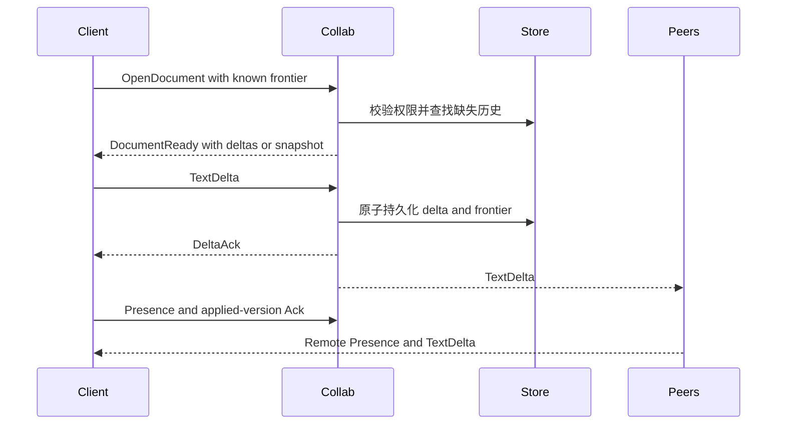

# 协作与 Delta 数据模型

本文记录武当的实时协作模型，以及它如何与 Git、Workspace、Agent 和 gRPC streaming
衔接。协议定义见 `proto/collab.proto`；Thread、Run 等控制面事件仍由 `proto/sync.proto`
同步。

## 两层版本控制

武当不试图用 CRDT 替换 Git，而是把版本控制拆成两个互补层：

| 层 | 粒度 | 用途 | 事实源 |
| --- | --- | --- | --- |
| Delta 协作层 | 每次文本编辑 | 自动保存、实时同步、归因、撤销和历史 | CRDT delta graph |
| Git 发布层 | 不可变快照 | 分支、提交、Tag、CI、Pull Request 和发布 | Git / GitHub |

用户不需要为了备份或分享当前工作而先执行 `git add`、`commit`、`push`。编辑产生的 delta
立即持久化并发送给其他 replica；需要发布时，再把一个确定的 causal version 物化为 Git
commit。

这个方向参考了 [DeltaDB: The Future of Version Control](https://delta.dev/blog/future-of-version-control)：
Git 擅长命名和发布快照，CRDT 层负责持续保存与协作。

## 文档、Replica 与 Delta

### Document

Document 是一个 Workspace 中文本文件的协作身份。路径可以变化，因此稳定身份使用
`document_id` 和 `file_id`，路径只是当前属性。

### Replica

每个可以产生编辑的桌面客户端或 Runner 都是一个 Replica。`replica_id` 必须稳定持久化，
该 Replica 内的 `sequence` 严格递增：

```text
DeltaId = (replica_id, sequence)
```

二者组合在整个 Document 历史中唯一。不能在重装、崩溃恢复或并行进程中复用已经发出的
sequence。

### TextDelta

一个 TextDelta 是同一事务中的一组文本编辑：

```text
TextDelta {
  delta_id
  based_on: CausalVersion
  edits: [{ start_utf8, end_utf8, inserted_text }]
  attribution: { actor_id, agent_id, run_id, prompt_message_id }
}
```

`start_utf8..end_utf8` 是 `based_on` 版本中的半开 UTF-8 byte range，而不是接收者当前
buffer 的位置。接收者通过 fragment index 把旧版本的位置翻译到当前版本。

同一 delta 的 edits 必须互不重叠，并按 `start_utf8` 升序编码；应用时可以从后向前修改
源版本。服务端拒绝无效 UTF-8 边界、重复 DeltaId 和不存在的 causal parent。

## Causal Version

每个 Document 从一个明确的 Git blob 开始：

```text
CausalVersion {
  base: (repository_id, commit_oid, path, blob_oid)
  frontier: [DeltaId, ...]
}
```

`frontier` 是当前版本因果图中尚未被其他可见 delta 包含的 heads，而不是按机器时间排序的
修改列表。发送新 delta 时，它的 `based_on.frontier` 成为父集合。

服务端和客户端必须把 frontier 按 `(replica_id, sequence)` 规范排序后再计算 digest。时间戳
只用于展示，不能参与合并顺序。

### 并发合并

如果两个 delta 基于同一版本在同一位置插入文本，两边必须得到相同结果。协议使用 DeltaId
的确定性全序作为并发 tie-break。具体排序规则属于存储格式的一部分，一旦发布不能随意改变。

常见情况仍然很便宜：绝大多数远端 delta 都直接基于本地当前 frontier，可以直接应用。只有
离线恢复、网络乱序或真实并发时，才需要跨版本位置翻译。

## Fragment Index

只保存当前字符串无法回答这个关键问题：

> “版本 V 中位置 X 所指的文本，在当前版本位于哪里？”

因此每个 Document 同时维护：

1. 当前可见文本；
2. 按当前文本顺序排列的 fragment index；
3. 每个 fragment 的来源：Git blob 或某个 DeltaId 的第几个 insertion；
4. 已删除但仍可被 Anchor 引用的 tombstone；
5. causal graph 和当前 frontier。

fragment index 推荐实现为持久化 B+ tree。内部节点保存子树摘要，叶节点保存连续 fragment。
每次修改只复制从根到受影响叶子的路径，未变化节点结构共享，避免为每个版本复制整棵树。

这与 DeltaDB 文中描述的“多头、结构共享 fragment index”一致：每个 causal version
拥有自己的 root，但绝大多数节点与前一版本共享。

## Stable Anchor

普通 line、column 或 current offset 会在协作编辑后漂移。Presence、选区、评论和后台任务
需要 StableAnchor：

```text
StableAnchor {
  fragment: GitFragment | DeltaFragment
  offset_utf8
  bias: left | right
}
```

Anchor 指向不可变来源片段的一侧。即使该字符被删除，tombstone 仍允许系统解析“如果恢复，
它会出现在哪里”。`bias` 决定并发插入恰好发生在 Anchor 位置时，Anchor 留在插入内容左侧
还是右侧。

Review 评论有两种锚点：

- 对实时 Document 的评论使用 StableAnchor；
- 对不可变 Change Set 的评论使用 `change_set_id + file_change_id + hunk_id + side + line`。

二者不能混用。Change Set 锚点应该保持历史稳定，而实时 Anchor 应随协作编辑移动。

## 双向流协议

`CollaborationService.SyncDocument` 是 bidirectional gRPC streaming。一个 stream 只同步一个
Document，以便独立实施背压、权限撤销和恢复。



### Stream 规则

- 第一条客户端消息必须是 `OpenDocument`。
- 权限校验完成前，服务端不接收 delta。
- Delta 必须先持久化，再发送 `DeltaAck` 或广播给其他 replica。
- Presence 是短暂状态，不进入永久 causal history；断线或 TTL 到期后删除。
- Ack 表示 replica 已应用到某个 frontier，可用于压缩和监控落后程度。
- Heartbeat 只检测半开连接，不改变 Document version。
- 每个 stream 有有界发送队列；慢客户端超过阈值后收到 `ResyncRequired`，不能无限占用内存。

### 断线恢复

客户端重连时发送最后持久化的 local frontier：

1. 服务端仍保留所有缺失 delta：返回按因果顺序排列的 `DeltaBatch`。
2. 历史已经压缩：返回自包含 `DocumentSnapshot`。
3. Git base 已变化且不能自动重放：返回 `BASE_CHANGED`，进入显式 rebase 流程。
4. frontier 含未知或非法 parent：返回 `INVALID_FRONTIER`，保留本地恢复副本并停止写入。

客户端必须把未确认的 local delta 保存在 write-ahead log。重连后以同一 DeltaId 重发，服务端
幂等确认，不能为重试生成新 ID。

## Snapshot、压缩与保存

第一版 Snapshot 包含 Git base 文本和从 base 开始的全部 delta，因此实现简单但会持续增长。
在证明正确性以后再增加 checkpoint：

- checkpoint 保存可见文本、fragment index、tombstone 和 causal frontier；
- checkpoint 内容寻址并写入对象存储；
- 只有所有受支持 replica 都确认过的历史才可以进入压缩候选；
- 压缩不能使仍存活的 StableAnchor 失效；
- 原始 delta 的 attribution 根据项目审计策略保留。

不要把“清理 tombstone”当成普通数据库 TTL。它需要基于 replica ack、Anchor 生命周期和项目
保留策略的可证明安全条件。

## Agent `apply_patch` 如何进入 CRDT

Agent 的 `apply_patch` 是工具输入格式，不是协作事实源：

1. Tool Call 记录原始 patch、Workspace expected revision 和待修改文件。
2. Host 在隔离 Checkout 中对确定的 base snapshot 预演 patch。
3. 每个文件的 before/after 被规范化为最小文本 edits。
4. 文本 edits 作为一个带 `run_id`、`agent_id`、`prompt_message_id` 的 TextDelta 事务提交。
5. 服务端接受 delta 后形成新的 causal version。
6. base/head snapshot 之间生成不可变 Change Set，Agent 模式用 diff renderer 展示。
7. 用户对 hunk 的评论锚定 Change Set；“Open in Edit”则打开 head version 的实时 Document。

因此 UI 绝不能只渲染 `apply_patch` 原始字符串。原始 patch 适合审计，接受后的 TextDelta
决定协作历史，Change Set 决定审阅视图。

文件新增、删除、重命名和 chmod 暂时使用带 `expected_workspace_revision` 的串行 Workspace
命令。新文件建立 Document 后，其文本继续走 CRDT。完整文件树 CRDT 需要解决目录循环、并发
rename/delete、大小写敏感和跨平台路径规则，不能套用文本算法草率实现。

## Git 互操作

### 发布

发布某个 causal version 时：

1. 冻结目标 version，不阻塞后续编辑；
2. 从该 version 物化完整 Workspace；
3. 生成 Git tree 和 commit；
4. 保存 `causal_version → commit_oid` 映射；
5. 推送分支并按用户授权创建 Pull Request。

发布过程中产生的新 delta 留在新的 frontier，不会偷偷进入正在发布的 commit。

### Rebase

Git 默认分支变化后，不是把 CRDT 历史变成一串 Git patch 盲目重放。系统以新 blob 为 base，
利用 fragment provenance 和文本 diff 迁移仍有效的 delta；存在歧义时产生可审阅的冲突
Change Set。

## 正确性不变量

- 同一组合法 delta，无论接收顺序如何，最终文本和规范 frontier 相同。
- DeltaId 永不复用，已经确认的 delta 内容不可改变。
- Ack 只在 delta 和新 frontier 持久化后发送。
- 所有 offset 明确标注 UTF-8、UTF-16 或 display 空间，不接收裸 `position: number`。
- StableAnchor 在保留其 origin/tombstone 的所有版本中可解析。
- Agent 和用户编辑经过同一 TextDelta 路径，不能维护两套合并算法。
- Git 发布绑定一个确定 causal version，不使用“当前最新”这种移动目标。

## 验证策略

- 对随机编辑顺序做 property test，验证 convergence。
- 对重复、丢失、乱序、断线重发做网络模型测试。
- 使用 emoji、组合字符、CJK、CRLF 和无效边界测试坐标转换。
- 为 Git rebase 和并发同位置插入保存固定 golden cases。
- 对 fragment index 做结构不变量、摘要、Anchor 解析和持久化恢复测试。

## 延伸阅读

- [DeltaDB: The Future of Version Control](https://delta.dev/blog/future-of-version-control)
- [Rope & SumTree](https://zed.dev/blog/zed-decoded-rope-sumtree)
- [Text Coordinate Systems](https://zed.dev/blog/zed-decoded-text-coordinate-systems)
